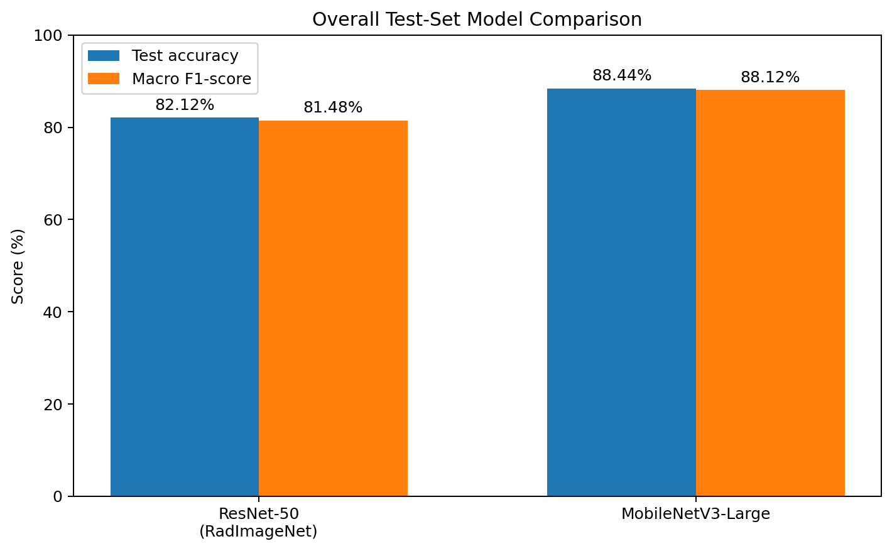
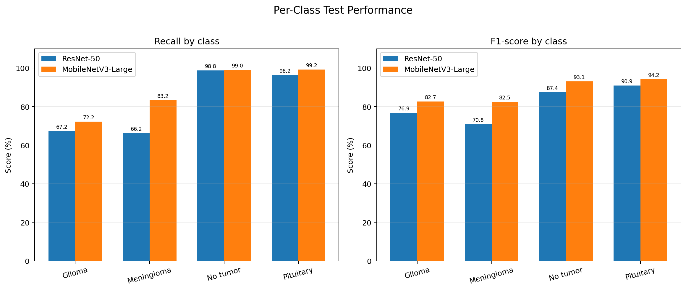
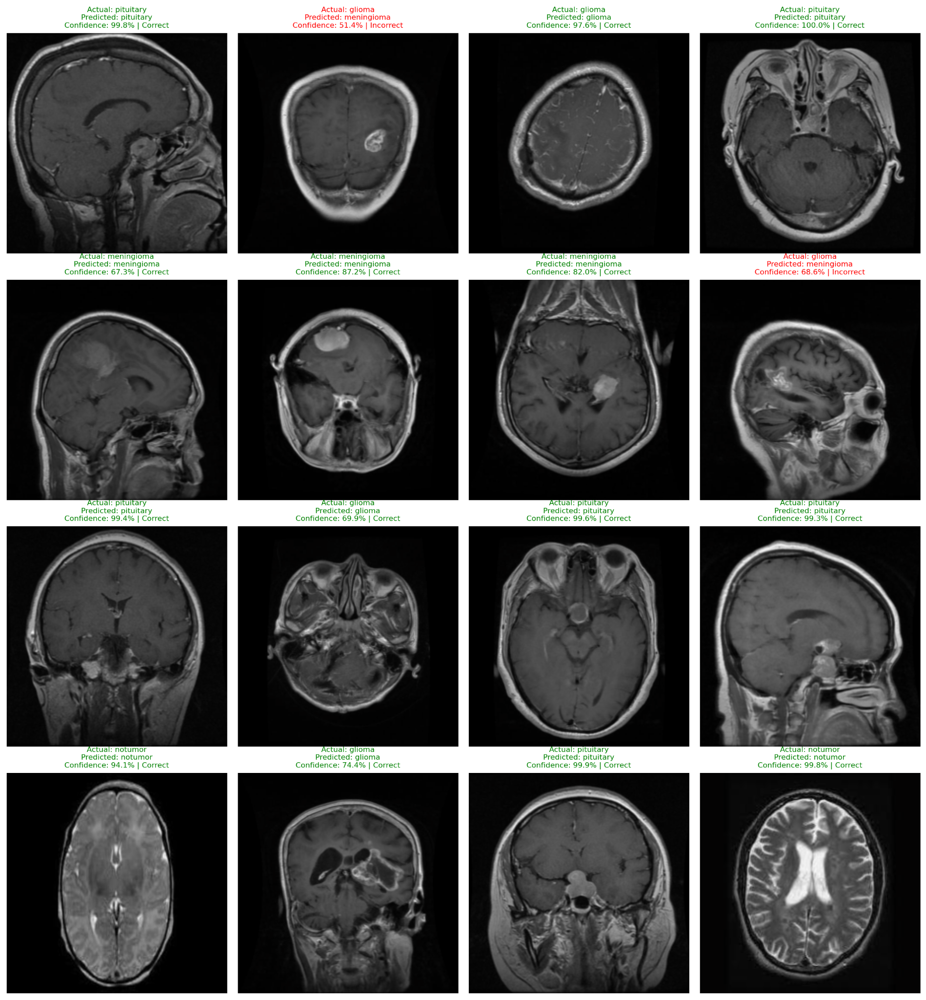
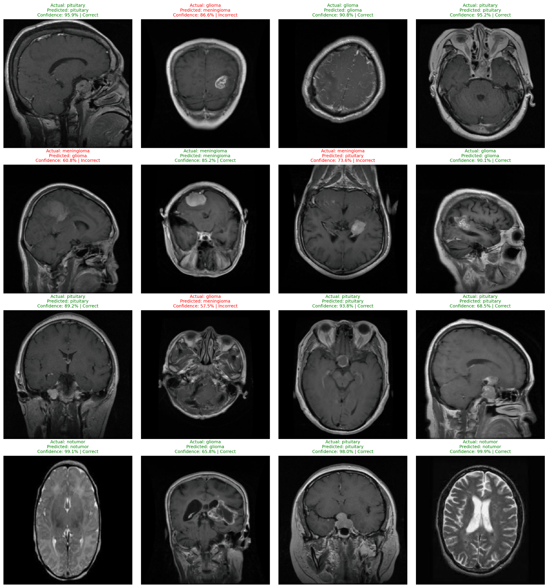

# Brain Tumor MRI Classification

A deep-learning image classification project that predicts one of four classes from a brain MRI image: **glioma**, **meningioma**, **no tumor**, or **pituitary tumor**. This project compares a fine-tuned **RadImageNet-pretrained ResNet-50** with **ImageNet-pretrained MobileNetV3-Large**.

> **Medical disclaimer:** This is an educational machine-learning project, not a medical device. It has not been clinically validated and must not be used to diagnose, rule out, or make treatment decisions about any person.

## Live demo

Try the deployed application: [Brain Tumor MRI Classifier](https://brain-tumor-classification-6uj9.onrender.com)

## Results at a glance

Both models were evaluated on the same held-out test set of **1,600 images** (400 images per class).

| Metric                | ResNet-50 (RadImageNet) | MobileNetV3-Large |
| --------------------- | ----------------------: | ----------------: |
| Test accuracy         |                  82.12% |        **88.44%** |
| Macro precision       |                  82.53% |        **88.97%** |
| Macro recall          |                  82.12% |        **88.44%** |
| Macro F1-score        |                  81.48% |        **88.12%** |
| Weighted precision    |                  82.53% |        **88.97%** |
| Weighted recall       |                  82.12% |        **88.44%** |
| Weighted F1-score     |                  81.48% |        **88.12%** |
| Correct predictions   |           1,314 / 1,600 | **1,415 / 1,600** |
| Incorrect predictions |                     286 |           **185** |



In this experiment, MobileNetV3-Large scored **6.32 percentage points higher in test accuracy** and had a lower measured per-image inference time. Timing depends on hardware, batch size, software versions, and measurement method.

## Per-class comparison

| Class      | ResNet-50 precision | ResNet-50 recall | ResNet-50 F1 | MobileNet precision | MobileNet recall | MobileNet F1 |
| ---------- | ------------------: | ---------------: | -----------: | ------------------: | ---------------: | -----------: |
| Glioma     |              89.67% |           67.25% |       76.86% |          **96.66%** |           72.25% |   **82.69%** |
| Meningioma |              75.93% |           66.25% |       70.76% |              81.82% |       **83.25%** |   **82.53%** |
| No tumor   |              78.37% |           98.75% |       87.39% |          **87.80%** |           99.00% |   **93.07%** |
| Pituitary  |              86.13% |           96.25% |       90.91% |              89.62% |       **99.25%** |   **94.19%** |



### Interpretation

- **MobileNetV3-Large performed better overall on this test set**, with higher test accuracy and macro F1-score.
- Glioma recall remains a weakness: MobileNetV3-Large identified 72.25% of the glioma images correctly.
- High recall for the no-tumor and pituitary classes does not establish clinical reliability.
- These results are specific to this dataset and split; performance may differ on images from other sources, scanners, and patient populations.

## Example predictions

The grids below show 16 example test-image predictions from each fine-tuned model. Each tile displays the dataset label, model prediction, softmax confidence, and whether the prediction matched the dataset label. Green indicates correct predictions; red indicates incorrect predictions.

### MobileNetV3-Large — 16 test examples



### Fine-tuned ResNet-50 (RadImageNet) — 16 test examples



These grids are qualitative examples, not a substitute for aggregate metrics. Softmax confidence is not a calibrated probability of a clinical diagnosis.

## Project task

The classifier maps each MRI image to one of four labels:

| Label        | Meaning                |
| ------------ | ---------------------- |
| `glioma`     | Glioma tumor class     |
| `meningioma` | Meningioma tumor class |
| `notumor`    | No-tumor class         |
| `pituitary`  | Pituitary tumor class  |

## Models

### 1. ResNet-50 pretrained on RadImageNet

- Started with a ResNet-50 architecture.
- Loaded the available RadImageNet pretrained backbone weights.
- Replaced the original final layer with a four-class classification head.
- Initially trained the classification head, then fine-tuned `layer4` and the final head.

### 2. MobileNetV3-Large pretrained on ImageNet

- Started with torchvision's ImageNet-pretrained MobileNetV3-Large.
- Replaced the final classifier layer with a four-class output layer.
- Trained the classifier head, then fine-tuned the final feature block and classifier.

## Data and preprocessing

- Dataset folders: `Training/` and `Testing/`.
- Four classes: `glioma`, `meningioma`, `notumor`, `pituitary`.
- Training folder: 5,600 images total, 1,400 per class.
- Held-out test folder: 1,600 images total, 400 per class.
- A stratified 80/20 split of the `Training/` folder was used for training and validation: 4,480 training images and 1,120 validation images.
- Images were resized to 224 × 224 and normalized with ImageNet mean and standard deviation.
- Training included random horizontal flipping.

```python
transforms.Compose([
    transforms.Resize((224, 224)),
    transforms.RandomHorizontalFlip(p=0.5),  # training only
    transforms.ToTensor(),
    transforms.Normalize(
        mean=[0.485, 0.456, 0.406],
        std=[0.229, 0.224, 0.225]
    )
])
```

The test set was used for the reported final metrics. Avoid using it repeatedly to select hyperparameters or make training decisions, as this can bias the final estimate.

## Training summary

| Setting                               | ResNet-50 (RadImageNet)           | MobileNetV3-Large                 |
| ------------------------------------- | --------------------------------- | --------------------------------- |
| Input size                            | 224 × 224                         | 224 × 224                         |
| Number of classes                     | 4                                 | 4                                 |
| Initial stage                         | Frozen backbone; train classifier | Frozen backbone; train classifier |
| Fine-tuning stage                     | `layer4` + final layer            | Final feature block + classifier  |
| Optimizer                             | Adam                              | Adam                              |
| Loss                                  | Cross-entropy                     | Cross-entropy                     |
| Validation accuracy after fine-tuning | 89.38%                            | 93.21%                            |

## Repository structure

```text
brain-tumor-classification/
├── assets/
│   ├── model-comparison.png
│   ├── class-metrics-comparison.png
│   ├── mobilenetv3-prediction-examples.png
│   └── resnet50-prediction-examples.png
├── .gitignore
├── Brain_tumor_classifier.ipynb
├── Dockerfile
├── README.md
├── brain_tumor_mobilenetv3_large.pth
├── main.py
├── model.py
├── requirements.txt
└── test_model.py
```

## Run the application locally

### Prerequisites

- Git
- Docker Desktop (running)

### Steps

Clone the repository and move into the project directory:

```bash
git clone https://github.com/sushilkumarsahoo1/brain-tumor-classification.git
cd brain-tumor-classification
```

Build the Docker image:

```bash
docker build -t brain-tumor-classifier .
```

Start the application:

```bash
docker run --rm -p 8000:8000 brain-tumor-classifier
```

Open [http://localhost:8000](http://localhost:8000) in your browser, upload a brain MRI image, and click **Classify MRI**.

To stop the application, press `Ctrl+C` in the terminal.

## Getting started

### Requirements

- Python 3.10 or newer (use the version that matches your notebook environment)
- PyTorch
- torchvision
- scikit-learn
- pandas
- matplotlib
- seaborn
- Pillow
- Jupyter Notebook or JupyterLab

### Install dependencies

Create a `requirements.txt` based on the packages used in your notebook. A starting list is:

```text
torch
torchvision
scikit-learn
pandas
matplotlib
seaborn
Pillow
jupyter
```

Install with:

```bash
python -m venv .venv
source .venv/bin/activate  # macOS/Linux
# On Windows: .venv\Scripts\activate
pip install -r requirements.txt
```

Open the notebook and run its cells in order. Update the dataset path in the notebook to match your environment. The full dataset is not included in this repository.

## Limitations

- **Not clinically validated.** The model is for learning and experimentation only.
- **Potential dataset bias.** Image dimensions and visual characteristics may vary between classes. The model could learn source or preprocessing differences instead of solely learning tumor-related features.
- **Generalization is unknown.** Evaluation on this held-out dataset does not show how the models perform on independent hospitals, scanners, or patient populations.
- **Patient-level splitting should be verified.** If multiple slices or images from the same patient occur across splits, test performance may be overly optimistic. Patient identifiers and dataset provenance should be checked.
- **Confidence is not certainty.** Softmax scores should not be interpreted as validated diagnostic probabilities.

## Acknowledgements

- **RadImageNet:** pretrained weights used for the ResNet-50 experiment.
- **Torchvision / ImageNet:** pretrained weights used for MobileNetV3-Large.
- \*\*Dataset:https://www.kaggle.com/datasets/masoudnickparvar/brain-tumor-mri-dataset

---

**Current experimental winner:** MobileNetV3-Large, based on the reported test accuracy, macro F1-score, and measured inference time. This is a dataset-specific result, not evidence that the model is ready for medical deployment.
